<!-- ========================================================================= -->
<!--                           OPEN TANGERINE FOR WINDOWS                       -->
<!-- ========================================================================= -->

<div align="center">

<!-- Animated Header Banner -->

<br/><br/>

<!-- Master App Logo -->
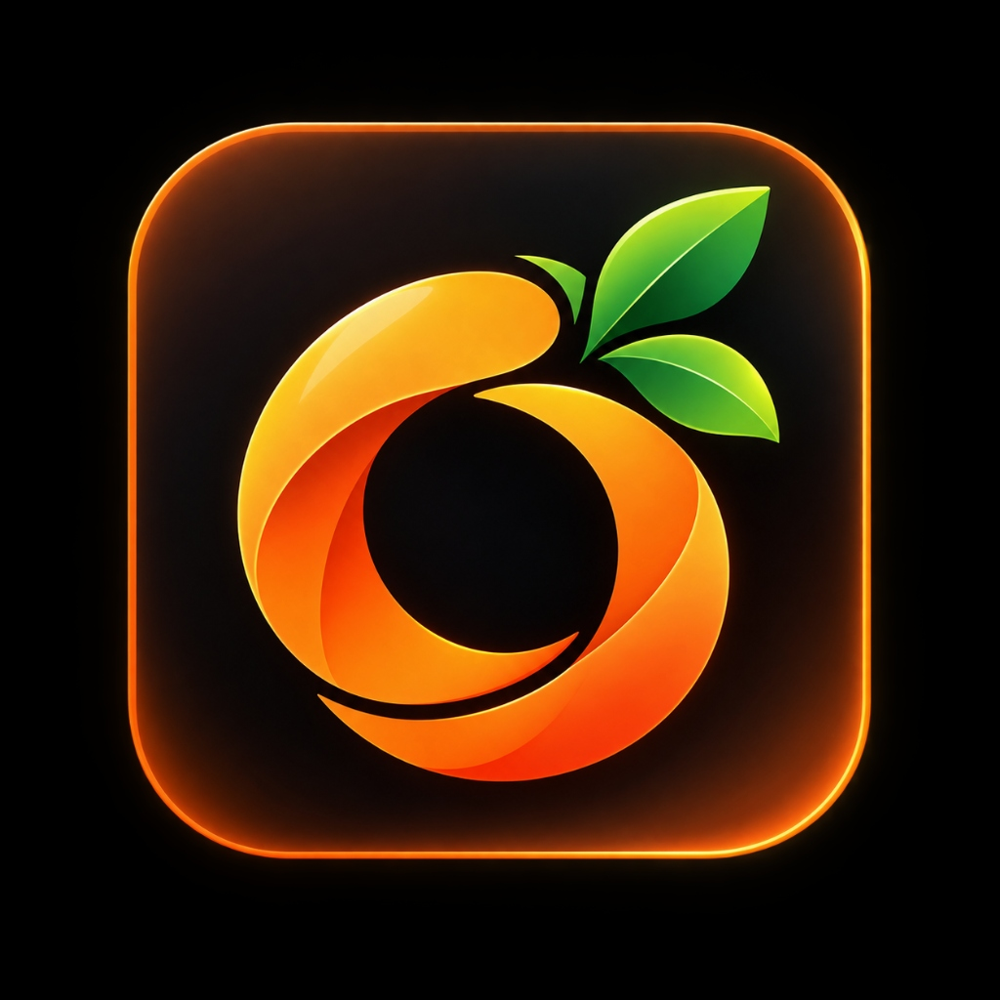

# Open Tangerine for Windows

<p align="center">
  <strong>A fluid, native radial wheel and instant media powerhouse for the files you drag.</strong><br/>
  <em>Hold a modifier, drag any file from File Explorer or Desktop, and release to convert, trim, compress, or edit.</em>
</p>

<!-- Animated Typing SVG Line Cycler -->
<a href="https://github.com/open-tangerine/open-tangerine">
  
</a>

<br/><br/>

<!-- Shields.io Badges -->
<p align="center">
  <a href="https://github.com/open-tangerine/open-tangerine/releases">
    
  </a>
  <a href="https://www.rust-lang.org/">
    
  </a>
  <a href="https://slint.dev/">
    
  </a>
  <a href="#-verification--test-metrics">
    
  </a>
  <a href="LICENSE">
    
  </a>
  <a href="#-security-privacy--data-safety">
    
  </a>
</p>

[Downloads](#-installation--downloads) • [The 3 Radial Wheels](#-the-three-radial-wheels) • [18+ Tool Windows](#-18-interactive-tool-windows) • [Controls & Shortcuts](#-controls--shortcuts) • [Architecture](#-architecture--engineering-highlights) • [Building from Source](#-building-from-source)

</div>

---

## 💡 What is Open Tangerine?

Converting a video, cropping an image, extracting pages from a PDF, or trimming an audio clip on Windows usually means hunting down clunky web utilities, fighting ad-heavy converters, or opening sluggish multi-gigabyte editing suites.

**Open Tangerine changes this fundamentally.** It lives quietly in your system tray, watching for file drags. The moment you start dragging files out of Windows File Explorer or Desktop while holding a modifier key (**Shift**, **Ctrl**, or **Alt**):

1. **Direct Tactile Wheel**: A hardware-composited, per-pixel alpha-transparent radial wheel appears directly beneath your cursor.
2. **Context-Aware Actions**: The wheel inspects the files under your mouse in real time and highlights only relevant operations (video tools for MP4s, page organizers for PDFs, color balance for photos, lossless tables for CSV/XLSX).
3. **Instant Execution or Precision Cards**: Hover over an action and release. Simple conversions run immediately in the background with zero terminal popups. Advanced operations open dedicated, lightweight native tool cards with live scrubbing, dual-handle timelines, and instant previews.

---

## 🎯 The Three Radial Wheels

Tangerine provides three distinct radial wheels tailored to different stages of file handling. You can switch between them instantaneously by holding the corresponding modifier key or simply **scrolling your mouse wheel** while dragging:

| Wheel | Activation Modifier | Focus Area | Example Operations |
| :--- | :--- | :--- | :--- |
| **Convert Wheel** | <kbd>Shift</kbd> *(while dragging)* | Quick format shifting & lossless transcoding | MP4, WebM, GIF, MP3, WAV, PNG, JPEG, WebP, AVIF, PDF, XLSX, ZIP |
| **Tools Wheel** | <kbd>Ctrl</kbd> *(while dragging)* | Interactive editing, transformations & media studio | Trim, Split, Crop, Compress, Speed, Join, Normalize, Annotate, Collage |
| **File Actions Wheel** | <kbd>Alt</kbd> *(while dragging)* | Native Windows file system operations & privacy | Copy Path, Duplicate, Nearby Share, Zip Archive, Unpack, Redact, Exif |

<div align="center">

### Radial Wheel Appearance (Dark & Light Modes)

| Dark Theme (`#1A1A1A`) | Light Theme (`#F7F6F4`) |
| :---: | :---: |
| 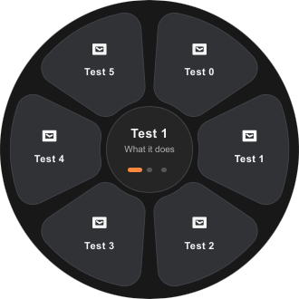 | 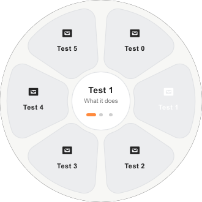 |
| *Hardware-composited layered window with per-pixel alpha transparency* | *Automatic adaptation to Windows system theme or custom user preference* |

</div>

---

## 🛠️ 18+ Interactive Tool Windows

Beyond one-click quick conversions, Open Tangerine includes a complete suite of **18+ dedicated interactive tool cards**. Each card is drawn with native Slint software rendering on a 32-bit Win32 layered window, featuring sub-pixel timeline precision, live waveforms, and zero flicker:

### 🎬 Video Powerhouse

<table>
  <tr>
    <td width="50%" align="center">
      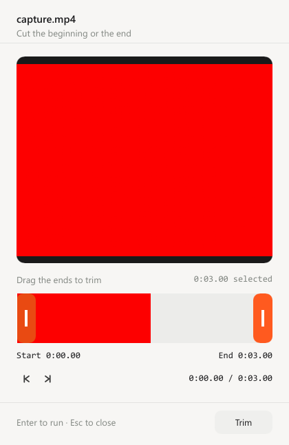
      <br/><strong>✂️ Trim & Cut Video</strong><br/>
      <em>Dual-handle timeline scrubbing with sub-second precision, spacebar preview slideshow, and lossless stream copy.</em>
    </td>
    <td width="50%" align="center">
      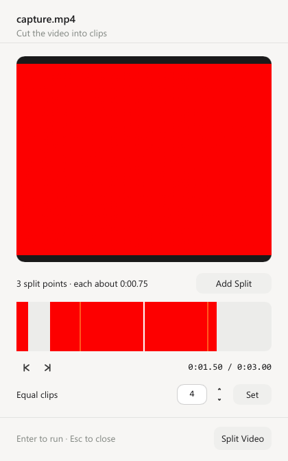
      <br/><strong>🔪 Split Video</strong><br/>
      <em>Multi-cut timeline markers with equal segment splitting and rapid batch chapter generation.</em>
    </td>
  </tr>
  <tr>
    <td width="50%" align="center">
      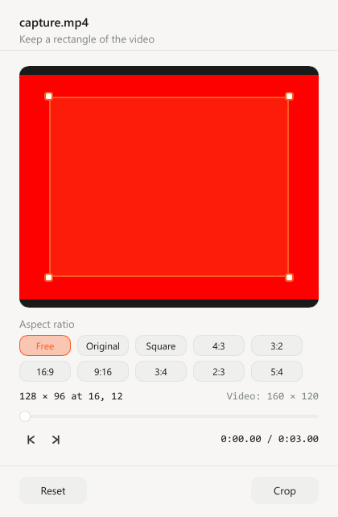
      <br/><strong>📐 Crop & Resize</strong><br/>
      <em>Interactive aspect ratio presets (16:9, 4:3, 1:1, 9:16 vertical video) and freeform crop boxes with live dimension readout.</em>
    </td>
    <td width="50%" align="center">
      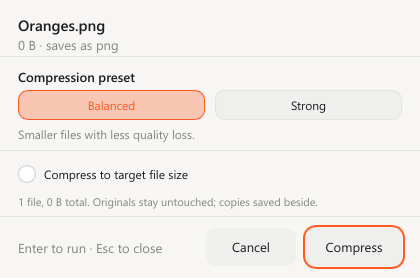
      <br/><strong>🗜️ Smart Compress</strong><br/>
      <em>Intelligent bitrate calculation for target sizes (Discord 25MB, Email 10MB, Web) with visual quality tuning.</em>
    </td>
  </tr>
  <tr>
    <td width="50%" align="center">
      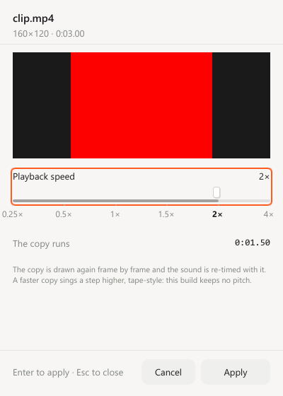
      <br/><strong>⚡ Change Playback Speed</strong><br/>
      <em>Variable playback rate multipliers (0.25x slow motion to 4.0x hyper-lapse) with optional audio pitch correction.</em>
    </td>
    <td width="50%" align="center">
      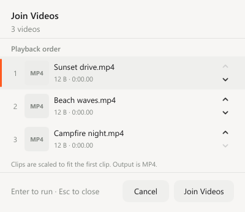
      <br/><strong>🔗 Join Videos & Lossless Concat</strong><br/>
      <em>Drag-and-drop file reordering, video thumbnail verification, and fast stream-copy concatenation.</em>
    </td>
  </tr>
  <tr>
    <td width="50%" align="center">
      
      <br/><strong>📸 Video Frame Snapshots</strong><br/>
      <em>Extract full-resolution still frames and keyframes across custom timeline intervals.</em>
    </td>
    <td width="50%" align="center">
      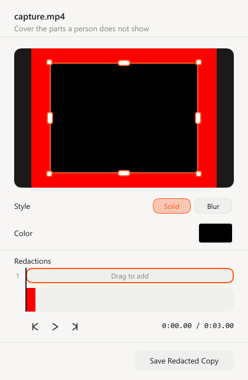
      <br/><strong>🕶️ Redact Video</strong><br/>
      <em>Temporal blur, mosaic pixelation, and black bars applied seamlessly across dynamic video regions.</em>
    </td>
  </tr>
</table>

---

### 🎵 Audio Studio & Visualizer

<table>
  <tr>
    <td width="50%" align="center">
      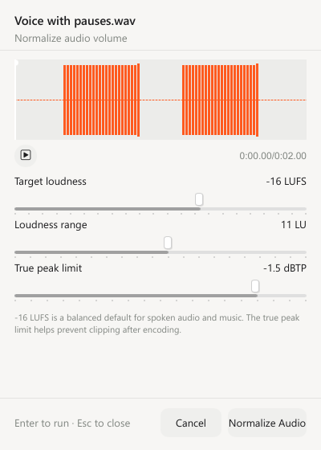
      <br/><strong>📢 Normalize Loudness</strong><br/>
      <em>Professional EBU R128 integrated loudness normalization, dynamic range adjustments, and true peak limiting.</em>
    </td>
    <td width="50%" align="center">
      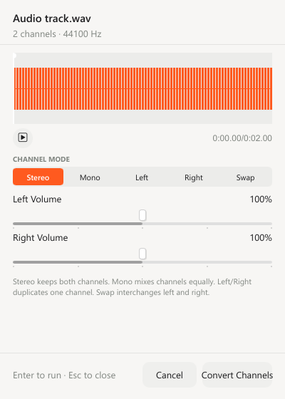
      <br/><strong>🎚️ Audio Channels & Remap</strong><br/>
      <em>Mono to Stereo expansion, Left/Right channel swap, channel isolation, and independent gain attenuation.</em>
    </td>
  </tr>
  <tr>
    <td width="50%" align="center">
      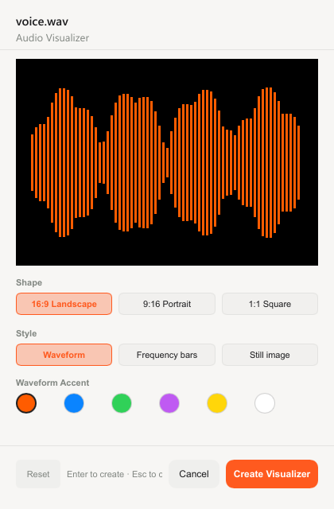
      <br/><strong>📯 Audio to Video Visualizer</strong><br/>
      <em>Transforms podcast and music tracks into animated video waveforms, spectrum bars, and reactive visualizers.</em>
    </td>
    <td width="50%" align="center">
      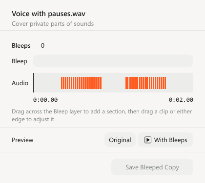
      <br/><strong>🔇 Redact & Bleep Audio</strong><br/>
      <em>Censor sensitive segments with standard 1kHz bleep tones, silence gaps, or acoustic noise overlays.</em>
    </td>
  </tr>
</table>

---

### 📸 Photo Studio & Image Processing

<table>
  <tr>
    <td width="50%" align="center">
      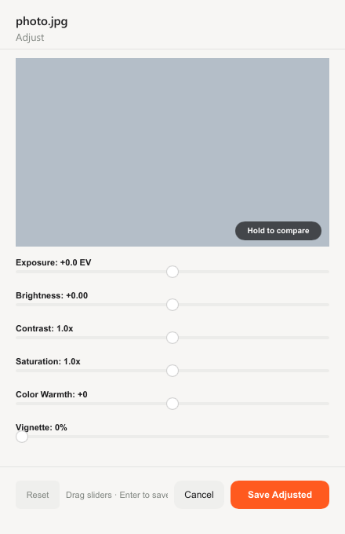
      <br/><strong>🎨 Photo Adjustments</strong><br/>
      <em>Live exposure, brightness, contrast, saturation, color temperature, and tint sliders with real-time feedback.</em>
    </td>
    <td width="50%" align="center">
      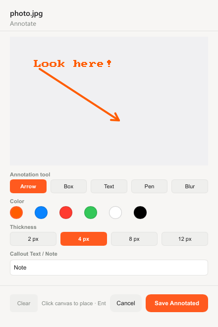
      <br/><strong>✏️ Annotate Photos</strong><br/>
      <em>Draw arrows, callout text, bounding boxes, highlights, and selective blur directly on your images.</em>
    </td>
  </tr>
  <tr>
    <td width="50%" align="center">
      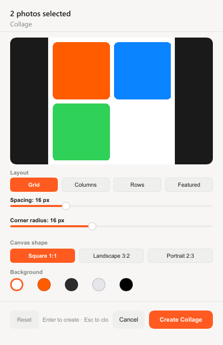
      <br/><strong>🖼️ Collage Maker</strong><br/>
      <em>Multi-photo layouts (Grid, Split, Hero Featured) with adjustable border spacing, corner rounding, and canvas fills.</em>
    </td>
    <td width="50%" align="center">
      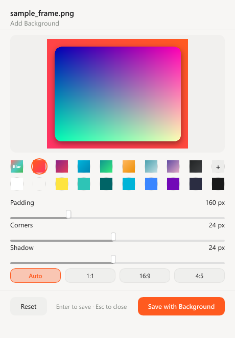
      <br/><strong>🔲 Frame & Presentation Canvas</strong><br/>
      <em>Adds framed studio presentations, soft drop shadows, padding ratios, and gradient or solid backdrops.</em>
    </td>
  </tr>
</table>

---

### 📄 PDF, Documents & Privacy

<table>
  <tr>
    <td width="50%" align="center">
      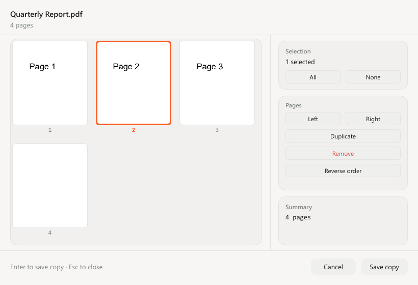
      <br/><strong>📑 Organize & Rotate PDF</strong><br/>
      <em>Multi-page PDF inspection via PDFium: drag-to-reorder pages, rotate clockwise/counter-clockwise, or extract selections.</em>
    </td>
    <td width="50%" align="center">
      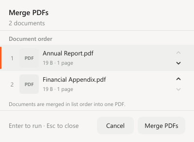
      <br/><strong>📎 Merge Documents</strong><br/>
      <em>Lossless multi-file PDF concatenation with instant thumbnail previews and visual ordering.</em>
    </td>
  </tr>
  <tr>
    <td width="50%" align="center">
      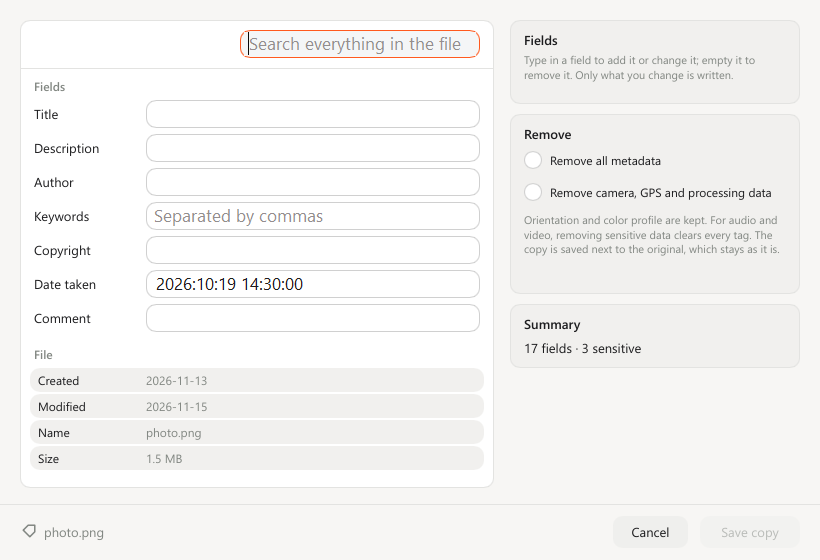
      <br/><strong>🏷️ Inspect & Strip Metadata</strong><br/>
      <em>Full Exif, ID3, and XMP tag inspector. Edit title, artist, and copyright tags or strip GPS/sensitive info with one click.</em>
    </td>
    <td width="50%" align="center">
      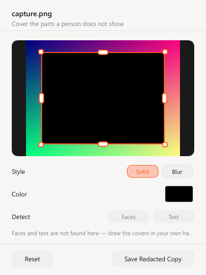
      <br/><strong>🙈 Visual Redaction (Blur & Blackout)</strong><br/>
      <em>Obscure faces, licenses, and private documents with gaussian blur, mosaic pixelation, or blackout blocks.</em>
    </td>
  </tr>
</table>

---

### ⚙️ Settings, Theming & System Tray

<div align="center">

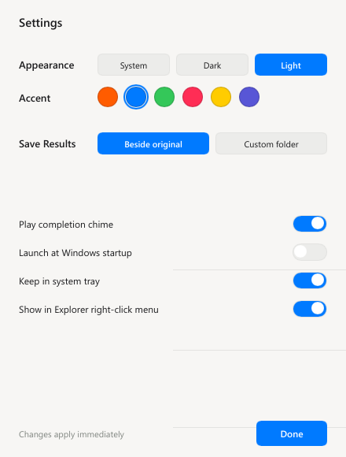

<p>
  <em>Full control over Light/Dark/System appearance, custom brand accent colors (Tangerine, Citrus, Coral, Ocean), wheel diameter, dead-zone tuning, and Windows startup preferences.</em>
</p>

</div>

---

## 🚀 In-Process Document Conversions

Open Tangerine contains zero-shell, pure in-process conversion pipelines written in safe Rust:

- **Spreadsheets & Data**: Lossless two-way conversions between **CSV**, **TSV**, and **Excel (.xlsx)**.
- **Documents & Web**: In-memory rendering of **Markdown (.md)** to styled **HTML** and portable **PDF**.
- **Vector Graphics**: Fast SVG rasterization to high-resolution PNG using direct software rasterizers.
- **Office Integration**: Direct Microsoft Office COM automation and LibreOffice headless fallback for Word (`.docx`), Excel (`.xlsx`), and PowerPoint (`.pptx`) export to PDF.
- **Archive Extraction & Bundling**: Streaming `.zip`, `.tar`, and `.tar.gz` archive handling with built-in directory traversal protection.

---

## 📦 Installation & Downloads

### Option 1: Windows Setup Wizard (`.exe`) — *Recommended*
Download the latest installer from the [Releases](https://github.com/open-tangerine/open-tangerine/releases) page:

- **File**: `OpenTangerine-Setup-0.1.0.exe`
- Automatically installs to `%LocalAppData%\Programs\Open Tangerine` (no UAC / admin privileges required).
- Sets up Start Menu shortcuts, optional Desktop icon, and optional startup with Windows.
- Includes clean Inno Setup uninstaller support.
- Supports unattended enterprise deployment: `OpenTangerine-Setup-0.1.0.exe /VERYSILENT /NORESTART`

### Option 2: Portable Standalone Package (`.zip`)
For users who prefer zero installation:

- **File**: `OpenTangerine.zip`
- Extract the archive to any folder on your machine.
- Double-click `open-tangerine.exe` to launch immediately.
- Includes bundled media utilities (`ffmpeg.exe`, `ffprobe.exe`) and Google PDFium engine (`pdfium.dll`).

### Option 3: Building from Source
Prerequisites: A working 64-bit Rust toolchain (Rust 1.92+ recommended) and MSVC C++ Build Tools.

```powershell
# 1. Clone the repository
git clone https://github.com/open-tangerine/open-tangerine.git
cd open-tangerine

# 2. Compile optimized release binary
cargo build --release

# 3. Launch Open Tangerine
.\target\release\open-tangerine.exe
```

---

## ⌨️ Controls & Shortcuts

| Input Gesture | Context | Effect |
| :--- | :--- | :--- |
| **Drag + <kbd>Shift</kbd>** | Dragging file(s) | Spawns the **Convert Wheel** (format transcoding) |
| **Drag + <kbd>Ctrl</kbd>** | Dragging file(s) | Spawns the **Tools Wheel** (18+ editing tool cards) |
| **Drag + <kbd>Alt</kbd>** | Dragging file(s) | Spawns the **File Actions Wheel** (clipboard, sharing, archiving) |
| **Mouse Wheel Up / Down** | Radial wheel open | Switches between Convert, Tools, and File Actions on the fly |
| <kbd>↑</kbd> / <kbd>↓</kbd> Keys | Radial wheel open | Steps between the three wheel modes |
| <kbd>←</kbd> / <kbd>→</kbd> Keys | Radial wheel open | Cycles highlighted wedge selection clockwise / counter-clockwise |
| **Release Mouse** / <kbd>Enter</kbd> | Segment highlighted | Executes the selected conversion or opens the dedicated tool card |
| <kbd>Space</kbd> | Timeline tool card | Toggles preview playback slideshow or audio snippet preview |
| <kbd>Escape</kbd> | Anywhere | Cancels and smoothly dismisses the wheel or active tool card |
| <kbd>Ctrl</kbd> + <kbd>Alt</kbd> + <kbd>T</kbd> | Global hotkey | Opens standalone development preview of the radial wheel |
| **Left Click Tray Icon** | System Tray | Opens the Settings & Preferences window |

---

## 🖥️ Command-Line Interface (CLI)

Open Tangerine is compiled with `#![windows_subsystem = "windows"]`, ensuring **zero black console flashes** when launching or running child processes. For automation or testing, standard CLI flags are supported:

```powershell
open-tangerine.exe [OPTIONS]
```

| Flag | Argument | Description |
| :--- | :--- | :--- |
| `--dev-wheel` | *None* | Spawns the radial wheel immediately on screen for UI inspection and development. |
| `--exit-after` | `<seconds>` | Automatically closes the application after specified duration (used in automated tests). |
| `--help`, `-h` | *None* | Displays application information and argument syntax. |
| `--version` | *None* | Prints the compiled Git revision and version details. |

### Diagnostic Logging
Structured timestamped logging can be enabled via the `OPEN_TANGERINE_LOG` environment variable:

```powershell
$env:OPEN_TANGERINE_LOG = "debug"   # Levels: trace, debug, info, warn, error
.\open-tangerine.exe
```

---

## 🏗️ Architecture & Engineering Highlights

```
src/
├── main.rs                  # Application entry point, CLI arguments & Windows subsystem config
├── app.rs                   # Win32 message loop, event dispatch, and tool window routing
├── session.rs               # Active OLE drag session tracking & multi-file resolution
├── settings.rs              # Persistent JSON preferences (theme, accents, wheel dimensions)
├── diagnostics.rs           # Nanosecond-precision scoped diagnostics & logging
├── media/                   # Core media engines & document processing
│   ├── adjustments.rs       # Exposure, contrast, temperature & color matrix balance
│   ├── annotate.rs          # Vector drawing, text callouts & annotation rendering
│   ├── audio.rs             # PCM waveform analysis, peak detection & channel remixing
│   ├── collage.rs           # Multi-photo grid compositor & border rounding
│   ├── command.rs           # Safe process argument generation with vector sandboxing
│   ├── convert.rs           # Direct format transcoder dispatch
│   ├── documents.rs         # In-process CSV/TSV/XLSX, Markdown & PDF pipelines
│   ├── frame.rs             # Drop shadow computation & presentation canvas renderer
│   ├── metadata.rs          # Kamadak-Exif tag parsing & multimedia tag editing
│   ├── pdf.rs               # PDFium runtime bindings for multi-page PDF rendering
│   └── visualizer.rs        # Audio spectrum analysis and video wave generator
├── platform/windows/        # Deep Win32 OS integration
│   ├── clipboard.rs         # Win32 clipboard provider
│   ├── droptarget.rs        # Native COM IDropTarget interface implementation
│   ├── explorer.rs          # Low-level mouse hooks & drag-and-drop detector
│   ├── input.rs             # Global low-level keyboard tracker (WH_KEYBOARD_LL)
│   ├── monitors.rs          # Multi-monitor enumeration & per-monitor DPI scaling
│   ├── overlay.rs           # 32-bit BGRA layered window host (WS_EX_LAYERED)
│   ├── tray.rs              # Shell_NotifyIcon system tray icon & notification menu
│   ├── windowhost.rs        # Shared DPI-scaled Win32 window host & capture harness
│   └── *window.rs           # 18 dedicated tool window hosts (Trim, Split, Crop, etc.)
├── radial/                  # Radial wheel business logic
│   ├── actions.rs           # Wheel action definitions, icons, and segment layout
│   ├── controller.rs        # Deterministic state machine for gesture recognition
│   ├── geometry.rs          # Trigonometry, hit testing, dead-zones, and sector angles
│   ├── registry.rs          # Media capability matrix and format qualification
│   └── tools.rs             # Safe tool handler with staging & publication guarantees
└── ui/                      # Slint presentation templates
    ├── animation.rs         # Smooth quadratic easing & wedge entrance transitions
    ├── theme.rs             # Design token palette (Tangerine #FF5A1F, Light & Dark)
    └── *.slint              # Declarative UI specifications for wheel & tool cards
```

### 1. Win32 Layered Window Composition
Rather than using heavy Direct3D or DirectComposition swapchains that encounter severe clipping artifacts with circular non-rectangular geometries, Open Tangerine uses a native **Win32 Layered Window** (`WS_EX_LAYERED`) paired with the **Slint Software Renderer**.
- Renders directly onto a 32-bit BGRA Device-Independent Bitmap (DIB).
- Updated with a single atomic call to `UpdateLayeredWindow`.
- Achieves buttery-smooth **60 FPS** transitions with true per-pixel alpha transparency, zero window frames, and zero flickers.
- Idle CPU usage: **0.0%**; baseline memory footprint: **~35 MB**.

### 2. Per-Monitor Dynamic High-DPI Awareness
Open Tangerine is fully **Per-Monitor V2 DPI Aware**. When dragging across displays with differing scale factors (e.g. 100% standard monitor to 200% 4K laptop screen), `WM_DPICHANGED` dynamically resizes the layered DIB buffer, recalibrates the wheel trigonometry, and re-renders fonts without any blurriness.

### 3. Process Confinement with Win32 Job Objects
All external helper processes (such as FFmpeg transcoders) are assigned to a dedicated Windows **Job Object** configured with `JOB_OBJECT_LIMIT_KILL_ON_JOB_CLOSE`. If Tangerine is terminated, all background worker processes are instantly and cleanly terminated by the OS kernel, preventing orphaned background tasks.

---

## 🔒 Security, Privacy & Data Safety

- **100% Offline & Private**: Open Tangerine has zero network sockets, zero crash analytics, and zero telemetry. Your files and metadata never leave your local computer.
- **Atomic Staging & Publish**: Conversions never write directly over your original files. Work is completed in a unique temporary staging file (`<name>.<pid>-<counter>.part`). Upon successful completion, it is atomically renamed. If a file with the destination name already exists, an automatic numbered suffix (`file (1).ext`) is assigned.
- **Zip Slip & Path Traversal Guard**: All archive extraction pipelines canonicalize paths and reject directory escapes (`../`), preventing zip-slip vulnerabilities.
- **Archive Bomb Protection**: Archive extractions enforce strict decompression ratio caps and maximum byte quotas to safeguard system storage against malicious compression bombs.
- **Argument Vector Sandboxing**: Command-line arguments for media utilities are constructed as structured argument arrays, eliminating shell injection vectors.

---

## 🧪 Verification & Test Metrics

Open Tangerine maintains an exhaustive automated verification suite:

```powershell
cargo test
```

- **664 Unit & Integration Tests**: 100% passing across geometry math, format negotiation, concurrency, and Win32 event handling.
- **Headless UI Visual Verification**: Automated capture tests generate visual verification shots in `target/shots/` to ensure visual parity with reference designs.
- **Windows Integration Harness**: Real OLE drag-and-drop validation run via PowerShell (`tests/windows-integration.ps1`).

---

## 🤝 Contributing

Contributions, bug reports, and suggestions are welcome!

1. Fork the repository.
2. Create a descriptive feature branch: `git checkout -b feature/amazing-feature`.
3. Verify all tests pass: `cargo test`.
4. Commit your changes using [Conventional Commits](https://www.conventionalcommits.org/): `git commit -m "feat(crop): add custom ratio preset"`.
5. Push to your branch and open a Pull Request.

---

## 📄 License

Open Tangerine for Windows is dual-licensed under either:

- **Apache License, Version 2.0** ([LICENSE-APACHE](http://www.apache.org/licenses/LICENSE-2.0))
- **MIT License** ([LICENSE-MIT](http://opensource.org/licenses/MIT))

at your option.

---

<div align="center">

**Crafted with 🍊 Tangerine orange passion for the Windows desktop.**

</div>
